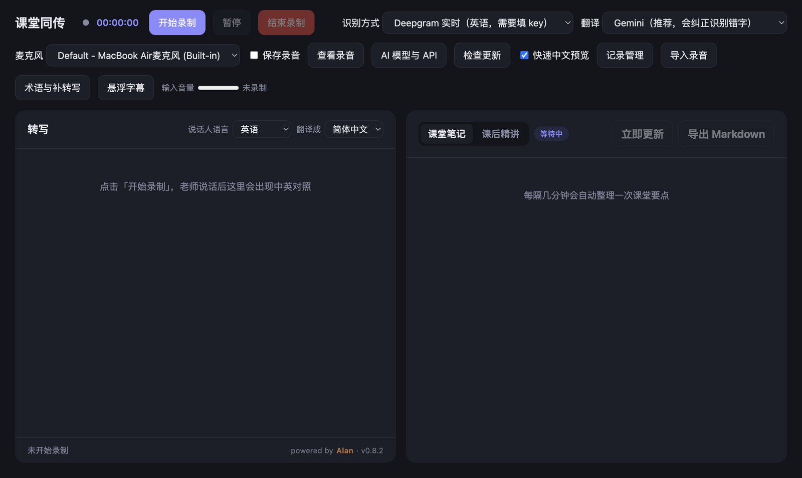

<p align="center"></p>

<h1 align="center">课堂同传</h1>

<p align="center">上课听不懂英文？课堂同传把老师说的话实时变成字幕，并翻译成中文；下课后自动整理成课后精讲。</p>

<p align="center"><b>预览版 v0.8.2</b> · 软件免费，云端 API 可能收费 · powered by Alan</p>

<p align="center"><a href="../../releases/latest"><b>下载最新版</b></a></p>



本文说明对应 `desktop/` 桌面版 v0.8.2；根目录 Python 网页版是历史实现，功能和配置不完全相同。

## 能做什么

- **实时字幕**：老师边说边出字，说完一句马上定稿并翻译成中文。英语课在所有电脑上都不用填 key 就能出字幕
- **翻得准**：AI 翻译会结合前几句话理解语境，会尝试在译文中按上下文纠正识别错误；实时原始转写不会被 AI 自动改写，也不能保证每处错误都能纠正
- **不填 key 也有中文**：内置本地翻译（英语译简体中文），装好就能用，不联网；新 Mac 还可以用苹果自带翻译
- **模型随你选**：除了 Gemini 和 Claude，还能接 DeepSeek、OpenAI、OpenRouter 等支持 OpenAI 兼容接口的模型，也能用自己电脑上的本地模型（Ollama）
- **电脑内部声音**：看网课、视频时，不用麦克风也能出字幕
- **课堂笔记**：配置好可用的 AI 服务后，约每 3 分钟在收到新字幕时整理一次要点，也可点「立即更新」
- **课后精讲**：结束录制后自动尝试生成复习资料（需可用的 AI 服务且至少 3 条转写），也可手动生成：带时间的章节大纲、讲解、术语表、思考题和核心要点，可以导出 PDF 或 Markdown
- **回听原声**：打开「保存录音」后，点字幕或课后精讲里的时间，就能从那一句开始回听老师的原话；录音只存在自己电脑上，运行 App 时自动清理过期录音；点「查看录音」可以看到所有录音，直接播放或删除
- **App 内更新下载**：启动时检查新版，也可点「检查更新」。自动选择当前系统和架构的安装包，显示下载进度并校验 SHA-256；下载后手动安装，不会自动重启。录制、收尾和生成精讲期间禁止打开安装包
- **防止自动睡眠**：录制（含暂停）、收尾和生成精讲期间临时阻止系统自动睡眠，结束后恢复；仍可锁屏，不保证合盖或手动睡眠后继续录音
- **收音与连接状态**：录制时显示输入音量；Deepgram 显示连接中、已连接、重连和停止状态，可选本机缓存与结束后补转写
- **术语表**：录制前添加专业词、人名和指定译法，供 AI 翻译、Gemini 识别和 Deepgram 参考
- **断线补转写**：主动开启后缓存 Deepgram 录音，结束时补回缺失时段；失败后保留缓存供重试
- **导入录音**：导入最多 50 MB、30 分钟的音频，选择语音服务并生成双语记录
- **编辑与重译**：修改原文或译文、保留最初识别原文，并可按当前翻译设置重新翻译该句
- **记录管理**：按正文搜索、重命名、分类，以及为说话人编号设置本记录内的姓名
- **会议纪要**：可选择生成会议摘要、决策、待办、负责人和截止时间；原文没有的内容标为未说明
- **悬浮字幕**：独立置顶窗口显示最新原文和译文，方便看视频或投屏

## 英译中实时优化（v0.8.2）

勾选主界面的 **快速中文预览**（默认开启）：英语草稿达到 4 个词后，在本机生成临时中文，标记「快速预览」；英文定稿后，仍由你选择的翻译服务生成最终译文。预览不写入记录、不额外调用云端 API，也不应用 AI 术语纠错，可能随识别修订而变化。关闭开关可减少本机计算。需要安装包内的英译中本地模型，短片段、超长草稿或本机忙碌时可能跳过预览。

- 英语 Deepgram 连接/本地识别模型在收音准备时提前启动；麦克风及 Windows 回环的音频分块由约 100ms 改为约 50ms。Deepgram 仍使用 Nova-3 和 300ms 停顿检测，避免为了响应速度过早切碎内容。
- 预览只保留一个正在处理的草稿和最新待处理草稿，过期结果不显示；最终 AI 结果不会被迟到的本机预览覆盖。主窗口及悬浮窗口均显示预览。
- 英译中且本地/苹果翻译可用时，实时 AI 翻译等待预算为 8 秒；Gemini 最多尝试两个可用模型并共享预算。失败后直接本地回退，故障服务冷却 15 秒，避免每句重复等待 3 秒、8 秒重试。冷却结束后新句子重新尝试；已回退的句子可在记录管理中重译。
- 本机短句测试中，模型加载约 193ms，首个测试短句约 296ms，后两个短句约 23–26ms。仅为这台 Mac 的本地翻译耗时，**不是从讲话到最终中文的总延迟**，不代表其它机器或云端速度。

## v0.8.2 新功能使用

- **术语与补转写**：每行填写 `英文 = 中文译法`，最多 40 行、1500 字符。AI 翻译和 Gemini 识别参考完整列表；Deepgram 使用按顺序截取的前 400 字节术语。术语不是强制替换规则，识别提示从新连接生效。
- **断线补转写默认关闭**。开启后仅适用于新的 Deepgram 英语录制，本机临时保存最多 2 小时原始音频；结束时把未确认时段上传 Deepgram，并按所选翻译模型处理文字，产生相应 API 费用。失败任务在 App 开启、空闲且开关开启时每分钟重试，也可在「记录管理 → 待补转写缓存」手动重试或删除。成功即删缓存，未完成缓存最长保留 7 天，清理需要 App 运行。边界处可能少量重复，请核对；期间不能切换识别方式或源语言。
- **导入录音**：支持当前系统能解码的 WAV、MP3、M4A、OGG 等，最大 50 MB / 30 分钟；选择 Deepgram、Gemini 或已配置的语音接口。语言和翻译模型沿用主界面。取消后保留已处理文字；退出 App 会中断导入，重启后临时导入音频清理，需重新导入。主动勾选保存原声才长期保留，沿用录音清理设置。
- **记录管理**：搜索标题、日期和正文；分类筛选填完整分类名。修改内容或说话人名称会清除旧总结/精讲/纪要，以免混用新旧内容；通过「打开总结」重新生成。每条记录使用 Markdown 和同名 JSON 共同保存，备份或移动时请一起保留；旧 Markdown 可读取并在首次保存时升级。
- **说话人命名**仅作用于当前记录，不识别真实身份。文件转写各段编号独立，不能自动认定不同片段的同号是同一个人；重新连接的实时编号也可能变化，需要人工核对。
- **会议纪要**：在右侧「课后精讲」页的总结类型中选择「会议纪要」，至少 3 条转写、需要可用 AI 服务。纪要与精讲分别保存，均可导出 Markdown/PDF。
- **悬浮字幕**：点击打开置顶窗口，可调整大小和拖动；再次点击或关闭窗口即可关闭。显示最新一句，不提供整场字幕回放。

## 支持哪些电脑

| 电脑 | 语音识别 | 能不能录电脑内部声音 |
|---|---|---|
| Mac，系统 macOS 26 或更新 | 苹果自带、本地实时或云端识别 | 可以 |
| Mac，系统 macOS 14.2 到 macOS 26 之前 | 本地实时（英语）或云端识别 | 可以 |
| Mac，系统 macOS 12 到 14.2 之前 | 本地实时（英语）或云端识别 | 不可以 |
| Windows 10 / 11 | 本地实时（英语）或云端识别 | 可以 |

云端识别包括 Gemini、Deepgram 和自定义语音接口。安装包面向上表中的 Mac、Windows x64 / ARM64；不支持 macOS 12 之前的系统。

五种识别方式的区别：

| 识别方式 | 特点 |
|---|---|
| 苹果自带 | 只有新 Mac 能用。免费，边说边出字，在电脑上处理 |
| 本地实时 | 所有电脑都能用。免费，不用填 key，边说边出字，在电脑上处理；目前只支持英语 |
| 云端（Gemini） | 需要填 Gemini key。一句一句出，慢一些，但支持更多语言，也能同时识别中文和英文 |
| 其他语音模型 | 自填 OpenAI 兼容转写接口；按停顿分段出字幕，语言和费用取决于服务；本机接口可免 Key |
| Deepgram 实时 | 固定使用 Nova-3 英语流式识别，需要 Deepgram Key 和网络；显示说话人编号，按服务用量收费 |

查看 Mac 系统版本：点屏幕左上角的苹果图标 → 关于本机。

## 下载安装

1. 点本页最上面的 **「下载最新版」**（或者本页右侧 Releases 下的「课堂同传 v0.8.2 预览版」），在打开页面最下面的 **Assets** 里下载安装包：
   - 苹果芯片的 Mac（M1、M2、M3、M4……）：下载 **「ClassTranslator-0.8.2-arm64.dmg」**
   - Intel 芯片的 Mac：下载 **「ClassTranslator-0.8.2-x64.dmg」**
   - Intel 或 AMD 芯片的 Windows 电脑（大多数电脑都是）：下载 **「ClassTranslator-0.8.2-win-x64-setup.exe」**
   - ARM 芯片的 Windows 电脑（比如部分 Surface、骁龙笔记本）：下载 **「ClassTranslator-0.8.2-win-arm64-setup.exe」**

   不知道 Mac 是哪种芯片？点屏幕左上角的苹果图标 →「关于本机」，看「芯片」那一行。不知道 Windows 电脑是哪种芯片？打开「设置 → 系统 → 系统信息」，看「处理器」那一行。注意不要点绿色的「Code → Download ZIP」，那是源代码，不是软件。
2. Mac：双击打开下载好的 `.dmg`，把「课堂同传」拖进「应用程序」文件夹，然后在「应用程序」里双击打开。
3. Windows：双击下载好的 `ClassTranslator-0.8.2-win-对应架构-setup.exe`，按安装向导一路「下一步」，装好后在开始菜单里找「课堂同传」。

### 第一次打开被系统拦住怎么办

课堂同传暂时还没有苹果开发者签名，所以第一次打开时，系统会弹出「未打开"课堂同传"」，说 Apple 无法验证它是否包含恶意软件。这是正常的，按下面做一次就好：

1. 在弹窗里点 **「完成」**（不要点「移到废纸篓」）。

   

2. 打开 **「系统设置」→「隐私与安全」**，往下翻到 **「安全性」** 一栏，能看到「已阻止"课堂同传"以保护 Mac」，点旁边的 **「仍要打开」**，输入电脑密码确认。

   

3. 再打开一次课堂同传，如果弹出确认窗口，点「仍要打开」。

之后再打开就不会被拦了。

### Windows 安装时提示「Windows 已保护你的电脑」

课堂同传暂时没有微软的代码签名，第一次运行安装程序时可能会出现这个提示：

1. 点提示里的「更多信息」。
2. 点出现的「仍要运行」，然后按安装向导一路「下一步」。

## 第一次使用

1. **隐私说明**：第一次打开会先告诉你哪些数据会上传、哪些不会，看完点「我知道了」。
2. **权限**：系统会询问能否使用「麦克风」和访问「文稿」文件夹，都点「允许」。用「电脑内部声音」时，还会询问能否「录制系统音频」，也点「允许」。
3. **填 Gemini key（推荐）**：点右上角「AI 模型与 API」，粘贴 Gemini key 后点保存。不填也能看到英文字幕和直译的中文（本地翻译或苹果自带翻译）；配置可用的 AI 服务后，才有结合上下文的翻译、课堂笔记和课后精讲（本地 Ollama 也可，不一定需要云端 Key）。用不了 Gemini 的话，也可以填其他模型，见下面的说明。

### 怎么免费申请 Gemini key

1. 用浏览器打开 Google AI Studio，用你的 Google 账号登录。
2. 点「Get API key」，再点「Create API key」。
3. 复制生成的 key，粘贴到课堂同传的「AI 模型与 API」里，点保存。

申请 Key 不等于所有模型都有免费额度。是否免费、额度和恢复时间以所选模型及账户的服务商控制台为准；开启付费的账户可能产生费用。也可以配置 Claude 或其他兼容服务。

### 用其他模型（DeepSeek、OpenAI、本地模型等）

申请不了 Gemini，或者想用别的模型，可以在「AI 模型与 API」的「其他模型」里填：

1. 在「服务商」里选一家（DeepSeek、OpenAI、OpenRouter、本地 Ollama），接口地址和推荐的模型名会自动填好；列表里没有的选「自定义」，填服务商给的 OpenAI 兼容接口地址和模型名。
2. 粘贴这家的 key，点保存。保存时会先测试一次，地址、模型名或 key 不对会当场提示。本地 Ollama 不用填 key。
3. 在主界面「翻译」里选「其他模型」。

说明：

- 「其他模型」用于翻译、课堂笔记和课后精讲；云端语音识别可独立选择 Gemini、Deepgram 或其他语音模型（英语课用「本地实时」识别不需要任何 key）。
- 翻译质量和速度取决于你选的模型。本地模型和带「思考」的模型比较慢，可能跟不上实时翻译。
- 这些服务大多按用量收费，费用由服务商向你收取，和课堂同传无关。

## 隐私

| 功能 | 数据去向 |
|---|---|
| 苹果自带识别、苹果自带翻译 | 只在你的电脑上处理，不上传 |
| 本地实时识别 | 只在你的电脑上处理，不上传 |
| 本地翻译 | 只在你的电脑上处理，不上传 |
| 保存录音（默认关闭） | 只存在你电脑的课堂记录文件夹里，不上传；默认保留 7 天，启动 App、运行中每 6 小时或修改保留天数时清理，可以改 |
| 云端识别（Gemini） | 有人说话的音频片段会发送给 Google |
| Deepgram 实时识别 | 录制时的音频持续发送给 Deepgram（不限于检测到人声的片段）；暂停时停止送音频、保持连接 |
| 其他语音模型识别 | 音频片段发送到你填写的接口；本机服务在本机处理 |
| Gemini 翻译、课堂笔记、课后精讲 | 转写的文字会发送给 Google |
| Claude 翻译、课堂笔记、课后精讲 | 转写的文字会发送给 Anthropic |
| 其他模型翻译、课堂笔记、课后精讲 | 转写的文字会发送给你自己填的那家服务商；用本地模型时不上传 |
| 检查/下载更新 | 向 GitHub 查询公开发布信息，下载匹配当前系统和架构的安装包及校验文件；不发送课堂内容或 API Key |
| 作者 | 收不到任何数据：App 不向作者发送课堂数据；所选云端功能仍会向相应服务商发送数据 |

- 课堂记录和课后精讲保存在「文稿/课堂同传」文件夹里（Windows 上是「文档\课堂同传」），可以随时删除。
- API key 加密后保存在你的电脑上（Windows 用系统加密，Mac 用 App 自己的加密），界面上只显示最后 4 位；调用服务时会作为认证凭据发送给对应接口，不会发送给作者。

选择本地识别不代表整套流程都离线：若翻译、笔记或精讲选用云端服务，文字仍会发送给该服务。苹果翻译语言包缺失时，代码还会尝试已配置的 AI 服务；需要完全离线时请使用本地英语识别和本地英译中，并避免配置云端 AI。首次使用苹果语言能力可能需要下载语言模型。

> **课堂录音前，请先确认学校和老师的规定。**

## 常见问题

**翻译显示「免费额度用完了」？**
程序会尝试轮换配置中的 Gemini 模型；实际额度与恢复时间由服务商决定。AI 翻译不可用时会尝试苹果翻译或本地翻译，但受语言包和语言对限制；这个回退只针对翻译，不会把云端识别、笔记或课后精讲自动变成本地功能。

**本地翻译和 AI 翻译有什么区别？**
本地翻译是直译，免费、不联网、不限量，目前只支持英语译成简体中文。它不会结合上文，语音识别听错的词它也会照着翻，专业课上效果明显不如 Gemini 等 AI 模型。建议把它当保底，想要更准的翻译还是填一个 key。

**苹果自带翻译提示「还没下载这对语言」？**
在「AI 模型与 API」里点「打开系统设置下载语言」，在「翻译语言」里下载英语和中文（简体）。

**选了「电脑内部声音」却没有字幕？**
到「系统设置」→「隐私与安全」→「录屏与系统录音」里，确认已经允许「课堂同传」。

**Windows 上麦克风列表是空的？**
到「设置 → 隐私和安全性 → 麦克风」，打开「麦克风访问权限」和「允许桌面应用访问麦克风」，然后重新打开课堂同传。

**录音占多少空间？会一直留着吗？**
「保存录音」默认是关的。打开后，一节 90 分钟的课大约占 170 MB，和课堂记录放在同一个文件夹里（`.wav` 文件）。默认保留 7 天，App 启动或运行中定期清理，可以在「自动清理」里改成 3 天、30 天或不清理；课堂记录和课后精讲不会被清理。

**怎么更新到新版？**
点「检查更新」或右下角新版提示，然后点「下载安装包」。下载完成并通过校验后，结束录制并等待精讲生成完成，再点「打开安装包」，按原来的安装方式覆盖更新。Windows 安装前请退出 App；Mac 把新版拖入「应用程序」替换旧版。没有正式签名时不提供静默安装，仍可能需要按系统提示允许打开。下载失败可重试或点「打开发布页」手动下载。现有 v0.7.3 及更早版本需要先手动安装一次 v0.8.2，之后才能使用此功能。

**录过的课在哪里？**
在「文稿/课堂同传」文件夹里（Windows 上是「文档\课堂同传」）。也可以在 App 右侧「课后精讲」标签里，从课程列表中选择以前的课。

## 给开发者

项目包含两部分：

- `desktop/`：桌面版 App（Electron）。使用 Node.js 22。下面的完整开发流程在 Mac 上执行，需要支持 macOS 26 API 的 Swift / macOS SDK、GitHub CLI `gh`、`curl`；编译脚本同时生成 arm64 和 x64 的 Swift 助手。
  ```bash
  cd desktop
  npm ci
  npm test        # 运行测试
  npm run models  # 下载本地实时识别模型（需要 GitHub 命令行工具 gh）
  npm start       # 开发模式运行
  npm run dist    # 打包 Mac 安装包（含打包后安全检查）
  npm run dist:win  # 打包 Windows 安装程序（苹果芯片 Mac 需要先装 Rosetta）
  ```
- 根目录：最初的网页版（Python + 浏览器），保留做参考。

Windows 原生构建见 `.github/workflows/build-windows.yml`：准备模型、执行 `npm run vendor` 后分别打包 x64 / ARM64；`npm start` 包含 Mac 的 Swift 编译步骤，不能在 Windows 上原样执行。

`.github/workflows/release-v0.8.2.yml` 从同一次提交构建 Mac 和 Windows 安装包，检查通过后发布 v0.8.2；日常文档修改不会触发该发布流程。

v0.7.3 起作者及应用标识统一为 Alan。Windows 保留原安装 GUID 以支持覆盖升级；Mac 应用标识更改后可能需要重新授予麦克风和系统音频权限。课堂记录目录和设置目录名称不变。

设计文档和开发计划在 `docs/superpowers/` 里，属于历史方案，不是当前功能清单；[当前实现对照](docs/implementation-status.md)说明代码入口和验证范围。

## 许可证

[MIT](LICENSE) · powered by Alan

安装包里包含的第三方组件和模型（sherpa-onnx、Kroko ASR 英语社区模型、Bergamot Translator、Firefox Translations 翻译模型、Silero VAD 等）及其许可证见 `desktop/assets/THIRD_PARTY_NOTICES.md`。其中本地实时识别使用的 Kroko 社区模型以 CC-BY-SA 协议提供，由 Banafo 发布，课堂同传未作修改。

## 自定义语音识别（v0.7.1 起）

在「AI 模型与 API → 其他语音模型」填写接口地址、语音模型名和 Key，保存后在「识别方式」选择「其他语音模型」。

- 服务须支持 OpenAI 兼容的 `POST /audio/transcriptions`：接收 WAV 文件、模型名和语言，返回 JSON `text`。接口地址可填基础地址（如 `https://api.openai.com/v1`）或完整转写地址。
- 模型必须支持音频转写，不能用普通聊天模型代替。翻译与语音识别可独立配置。
- 本机服务（localhost、127.0.0.1、::1）允许 HTTP 和免 Key；远程服务要求 HTTPS 和 Key。
- 音频按停顿分段发送，字幕在片段识别完成后出现；不是逐字流式识别。自动模式仅显示中英文。
- Key 加密保存。保存时仅校验配置格式，首次识别时验证服务；不会在保存时上传测试音频。

协议参考：[OpenAI 语音转写接口](https://developers.openai.com/api/reference/resources/audio/subresources/transcriptions/methods/create)。


## Deepgram 英文实时转写

桌面版新增「Deepgram 实时（英语，需要填 key）」，适合线下英文会议。使用 Nova-3 流式 API，草稿边说边更新，定稿后沿用原有中文翻译、笔记和录音保存功能。

1. 在「AI 模型与 API → Deepgram · 英文实时识别」填写自己的 Deepgram API key 并保存。
2. 在「识别方式」选择「Deepgram 实时（英语）」，选择麦克风，开始录制。
3. 翻译模型单独选择；Deepgram 只负责英文转写，不负责翻译。

字幕与导出的记录会显示「说话人 1 / 2 …」。这些是当前连接内的编号，不是身份识别；重新连接后可能变化，多人同时发言时不能保证区分准确。临时字幕会被最终结果替换，只有最终文字进入翻译和记录。

音频以 16 kHz、单声道、16-bit PCM 从桌面后台通过加密 WebSocket 持续发送至 Deepgram，按该服务用量收费。Key 使用现有加密设置保存，界面仅回显末四位；保存不发测试音频，首次连接时验证。修改 Key 后需重新开始录制。此实现适用于用户自带 Key 的桌面应用；不要将共享服务商密钥打包发布。

连接建立前最多缓冲 10 秒音频，发送积压过多会中止连接并提示。连接出错由现有会话机制在下一段音频到来时重试；未开启补转写时，同一节课累计两次异常退出后停止该识别方式，断线期间可能遗漏音频。开启补转写后会继续尝试重连，并在结束录制时补回未确认时段。暂停时保持连接，结束录制时请求处理剩余音频，收尾超时会明确提示。

开发验证：`cd desktop && npm ci && npm test`。Deepgram 协议测试使用模拟连接，不消耗账户额度；发布前需使用真实 Key 做现场收音、暂停/恢复及结束录制测试。

接口参考：[实时识别](https://developers.deepgram.com/reference/speech-to-text/listen-streaming)、[说话人区分](https://developers.deepgram.com/docs/diarization)。
